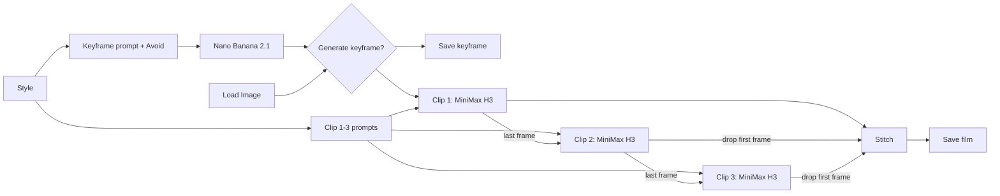
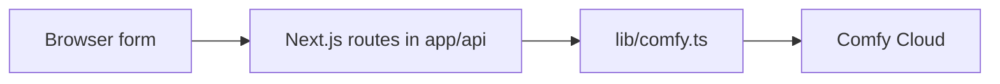

# Deploying a local ComfyUI workflow as an app

Move a local ComfyUI workflow to Comfy Cloud, prototype it in APP mode, call it through the Comfy API with Python, and wrap it in a TypeScript app.

## Overview

This tutorial follows one workflow from a local machine to a standalone web app. The example is Dreams Studio, the app in this repository. Its workflow turns a few text prompts into a keyframe image, then into three video clips that continue from each other and are stitched into one film.

The tutorial has four stages, one per section:

1. **Bring the workflow to Comfy Cloud.** Replace custom nodes with nodes Comfy Cloud already has, choose between Partner Nodes and open-weights models, and run the workflow in the browser.
2. **Prototype the app in APP mode.** Turn the workflow into a form, and decide which inputs a user should see.
3. **Call the workflow through the Comfy API.** Create an API key, export the workflow in API format, and run it from a short Python script, including the extra key that Partner Nodes need.
4. **Build a standalone app.** Wrap the workflow in a Next.js app that submits a job, handles all seven job statuses, reads outputs by node ID, keeps the key on the server, and turns each failure into a sentence a user can act on.

### Before you start

- A Comfy account, so you can sign in to [Comfy Cloud](https://cloud.comfy.org) and [platform.comfy.org](https://platform.comfy.org)
- Credits in a workspace on that account. Credits are Comfy's billing unit, and a workspace is where they live: every run spends one workspace's credits. You add credits on [platform.comfy.org](https://platform.comfy.org).
- Python 3.10 or later, for the first call in stage 3
- [Node.js](https://nodejs.org/) 22.6 or later, for the app in stage 4

> **Note:**
>
> [FFmpeg](https://ffmpeg.org/) is optional. You need it only to inspect the prompt and workflow that `SaveVideo` embeds in a finished film, with `ffprobe -v error -show_entries format_tags=prompt film.mp4`. Nothing in the Comfy Cloud path needs it.

### Get the sample code

Clone the repository, and run every later command from its root folder:

```sh
git clone https://github.com/XXJones21/Dream-studio.git && cd Dream-studio
```

## Bring the workflow to Comfy Cloud

**Comfy Cloud** is ComfyUI running in your browser at [cloud.comfy.org](https://cloud.comfy.org), on Comfy's GPUs instead of yours. The canvas works the way you know it, and Comfy Cloud gives you more powerful GPUs and models than a local machine. Dreams Studio started as a local workflow on a consumer GPU, where it was slow and its output was lower quality. Two things change when you move it: Comfy Cloud runs only the nodes and models it has installed, and every run spends credits. This stage handles both before you write any code.

### Open the workflow in Comfy Cloud

1. Go to [cloud.comfy.org](https://cloud.comfy.org) and sign in.
1. Drag the `workflows/Local/minimax_continuation_krea_workflow.json` file from your file manager onto the canvas.
1. Save the workflow. Once saved, the workflow appears in your **Workflows** sidebar.

> **Note:**
>
> To start from the finished Comfy Cloud version instead, drag in `workflows/dream_film.json`.

> **TODO:** Add the exact save command or menu path in Comfy Cloud to step 3.

<!--  -->

> **TODO:** Describe what Comfy Cloud shows when a workflow uses a node that isn't in the catalog (the warning text and how the node looks).

<!--  -->

### Review the example workflow

Before you replace anything, here's what the workflow does. It turns text into a short first-person film with sound. You write a style, a keyframe scene, and three clip actions. The Comfy Cloud version makes a keyframe image with Google's Nano Banana 2.1 Text to Image model, then three MiniMax H3 video clips, and stitches the three into one film of up to 45 seconds.



The seam between clips is where the continuation happens. Each clip starts on the last frame of the one before, so that frame appears twice. Clips 2 and 3 drop their first frame before the stitch, and the film plays straight through.

The repository holds three versions of this workflow:

| File | What it is |
| --- | --- |
| `workflows/Local/minimax_continuation_krea_workflow.json` | The original local version of Dreams Studio. It doesn't run on Comfy Cloud until you swap its custom nodes. |
| `workflows/dream_film.json` | The Comfy Cloud version in the save format, which holds the nodes as they sit on the canvas. Open it in ComfyUI or Comfy Cloud. |
| `workflows/dream_film.api.json` | The same workflow in the API format, which code sends to the Comfy API. The Python script and the app run this file. |

### Swap custom nodes for catalog nodes

Core nodes ship with ComfyUI. Custom nodes come from packs you create or install yourself. The Comfy Cloud **catalog** is the set of nodes and model files Comfy Cloud has installed: all core nodes plus a list of public custom node packs.

> **Important:**
>
> Comfy Cloud does not currently support installing custom node packs. A workflow can use only core nodes and the public packs already in the Comfy Cloud catalog.

The local workflow uses five custom nodes from three packs. All its other nodes are core nodes. Replace four of the custom nodes with core nodes, and delete the fifth. The finished Comfy Cloud version, `workflows/dream_film.json`, already has all five changes:

| Local node | What it did | Comfy Cloud replacement |
| --- | --- | --- |
| `UnetLoaderGGUF`, `CLIPLoaderGGUF` (ComfyUI-GGUF pack) | Load the GGUF model files | Core `UNETLoader` and `CLIPLoader`, with the int8 model files that are already on Comfy Cloud |
| `SeamlessContinuationLastFrame` (custom node written for this project) | Take the last frame of a clip | Core `ImageFromBatch` with `batch_index` set to −1, which picks the last image of the batch |
| `SeamlessContinuationStitch` (custom node written for this project) | Join the clips without repeating a frame | Core `VideoTemporalCrop` (drops the repeated seam frame) and `ConcatenateVideo` |
| `VRAM_Debug` (ComfyUI-KJNodes pack) | Report memory use | None. It only reports memory use, so delete it. |

Each swap keeps the workflow doing the same job:

- **The GGUF loaders.** GGUF is a compressed model format for fitting big models into a consumer GPU's memory. Comfy Cloud's GPUs don't need that, so the core loaders load the model files on Comfy Cloud directly.
- **The two project nodes.** They did two small jobs that core nodes already do: take the last frame of a clip, and join clips without repeating the seam frame.

The **Length**, **Width**, and **Height** nodes stay. They're `Basic data handling: IntCreate` nodes, from a public pack in the catalog, and each one stores a single value that every node needing it reads.

> **Note:**
>
> If a node has no catalog equivalent, the workflow needs a build: a packaged environment with those nodes, deployed as its own endpoint. See the [Serverless quickstart](https://docs.comfy.org/development/serverless/quickstart).

### Compare Partner Nodes and open weights

ComfyUI supports open-weights models and models served directly by partners. Some models exist both ways on Comfy Cloud, and the two impact your credit usage differently:

- An **open-weights** model runs on Comfy Cloud's own GPUs, inside your workflow. You pay for GPU time by the second, and nothing else.
- A **Partner Node** sends the request to a provider's paid API, for example Google's Nano Banana, so the model runs on the provider's side. You pay the provider's price per call, in credits. When you run a Partner Node from code, your code also sends your API key with the run (see [Run your first call from Python](#run-your-first-call-from-python)).

> **Important:**
>
> Partner Nodes bill per call on top of GPU time, and GPU time keeps billing while a run waits on a partner. Check a Partner Node's price before you choose it.

Dreams Studio uses the open weights for video and one Partner Node, Nano Banana, replacing the local Krea 2 keyframe.

> **Important:**
>
> Each run spends credits.

Run the workflow once in Comfy Cloud before you write any code. For a low-cost test, open `workflows/dream_film.json` and make 5 s clips from the default keyframe:

1. In the **Length** node, set the value to `124`, which makes each clip 5 s long.
2. Turn off the **Generate keyframe with Nano Banana?** switch, so the workflow uses the **Load Image** node instead of calling Nano Banana.
3. In the **Load Image** node, upload `workflows/default-keyframe.png`. The image the workflow names belongs to another account, so your run needs its own copy.
4. Select **Run**.
5. When the run finishes, download the film.

> **TODO:** Add where Comfy Cloud shows a run's outputs and how to download one, as steps under step 5.

<!--  -->

> **Tip:**
>
> Give each clip one action per 4 to 5 seconds, and end it where the next clip starts. A clip with too little action fills the time by undoing it, for example a door that opens, closes, and opens again.

## Prototype the app in APP mode

Comfy's APP mode turns a workflow into a simple form. You choose which inputs to expose, and Comfy Cloud builds the form. APP mode is a quick way to prototype an app before you write one: it shows what a user should touch, and using the form like a user shows where the logic breaks.

> **Note:**
>
> For the full feature, see [APP mode](https://docs.comfy.org/interface/app-mode) in the Comfy docs.

1. Open the workflow in Comfy Cloud.
2. Select **App** to switch the workflow to APP mode.

> **TODO:** Add the steps to build and share the APP mode app as an ordered list: the menu path, how to choose each input, who can open a shared app, and whose credits a run spends. Fix the field descriptions while you're there ("first 30 seconds", "24 fps + 1 end frame").

<!--  -->

The Dreams Studio form shows **Style**, a **Generate Keyframe Image?** toggle, **Keyframe Prompt**, **Avoid**, **Input Image**, **Width**, **Height**, **Total Frames**, and the clip actions. It also shows the Partner Node price for a keyframe image before you run.

### Choose the inputs for the form

The Comfy Cloud version of the workflow is already set up for an app. Each value a user changes lives in its own titled node, values that depend on another value are computed in the graph (the seam crops take **Length** minus 1 from a math node), and **Save keyframe** sits after the keyframe switch. An output node before the switch would make Nano Banana run, and bill, even with the switch off.

In APP mode, select the inputs a user should change. Using the form shows which of those are real choices:

| In the graph | APP mode | Standalone app |
| --- | --- | --- |
| Style, keyframe scene, Avoid, three clip actions | Text boxes | Text boxes |
| Keyframe switch and **Load Image** | Toggle and image | **Generate** or **My image** |
| Width, Height | Exposed | Fixed at 768 × 1344 |
| Total Frames | Any number | 5, 10, or 15 s (124, 243, or 362 frames) |

The frame counts follow MiniMax H3's frame grid. It accepts only frame counts of the form 17 × *k* + 5, where *k* is a whole number. At 24 fps, the closest counts to 5, 10, and 15 s are 124 (17 × 7 + 5), 243 (17 × 14 + 5), and 362 (17 × 21 + 5).

A user can't know that MiniMax H3 wants 362 frames and not 360, so the standalone app fixes the size and offers three lengths on the frame grid. Put only real choices in front of a user, and do the math for them.

## Call the workflow through the Comfy API

The **Comfy API** lets you run your workflows from code: a script, a backend, or an app. For a workflow that uses only catalog nodes, the endpoint is `https://cloud.comfy.org`, and your code sends the API format workflow with every call. Each call creates a **job**: one run of the workflow, with a job ID that you use to check its status and get its outputs. Nothing gets uploaded or built ahead of time. Comfy Cloud lists this shared endpoint as a deployment marked **Managed** and **Always on**, so you don't create one. You manage keys and deployments on the Developer Platform at [platform.comfy.org](https://platform.comfy.org).

To call the workflow, you need three things: an API key, the workflow in API format, and an SDK call. The Comfy SDKs are the client libraries that wrap the API: `comfy-sdk` for Python and `@comfyorg/sdk` for TypeScript. This tutorial uses version 0.4.0 of both.

### Open the Deploy page

The Deploy page on the Developer Platform shows the endpoint and instructions you can hand to a coding agent. You don't create a deployment for this tutorial, because the shared endpoint already exists. The **Copy for agents** text gives a coding agent a quick start on a script for your own workflow.

1. In Comfy Cloud, select **Deploy to Comfy API**. The Developer Platform home page opens. You can also go to [platform.comfy.org](https://platform.comfy.org) directly.
2. In the left menu, select **Comfy API** > **Deploy**. The **Call the Comfy Cloud API from code** page opens.
3. Select **Copy for agents** to copy the page's instructions for a coding agent.

> **TODO:** Add where the **Deploy to Comfy API** button sits in Comfy Cloud to step 1.

<!--  -->

### Create an API key

An API key is the secret that identifies your workspace on every request. Every key belongs to one workspace, and each run made with it spends that workspace's credits. The same key also lets Partner Nodes run inside a job.

1. Open [the API keys page](https://platform.comfy.org/profile/api-keys) on platform.comfy.org.
2. Create a key in a workspace that has credits.
3. Copy the key. The code in this tutorial reads it from the `COMFY_API_KEY` environment variable.

> **Important:**
>
> Do not put your API key in code or paste it into a coding agent.

An environment variable you set in a terminal lasts only for that terminal session. The Python steps below set it in the terminal. The app in stage 4 reads it from a `.env.local` file instead.

### Export the workflow in API format

A workflow has two JSON formats. The save format holds the nodes as they sit on the canvas: their positions, sizes, and links. **Save** writes it. The API format holds only each node's type (`class_type`) and its inputs, keyed by node ID. A node ID is the number that identifies a node in a workflow, such as `2213` for **Length**. The API addresses nodes only by ID, never by title. **Export (API)** writes it, and code needs it. This repository provides both:

| File | How to make it | Who uses it |
| --- | --- | --- |
| `workflows/dream_film.json` | **Save** (the save format) | People, who open it in ComfyUI or Comfy Cloud |
| `workflows/dream_film.api.json` | **Export (API)** (the API format) | Code, because the API runs only this format |

To export your workflow in API format:

1. Open the workflow in Comfy Cloud.
2. Select **Export (API)**.
3. Save the file in the `workflows` folder. In this repository, save it over `workflows/dream_film.api.json`.

> **TODO:** Add the menu path to **Export (API)** in step 2, in bold with `>` between levels.

<!--  -->

Here's the **Length** node (`2213`) in each format. In the save format, it carries its position, size, links, and its widget values twice (trimmed):

**Save format (nodes):**
```json
{
  "id": 2213,
  "type": "Basic data handling: IntCreate",
  "pos": [396.6428759624317, 12.380066990058278],
  "size": [270, 58],
  "outputs": [{ "name": "INT", "type": "INT",
                "links": [3783745238734738, 3783745238734739, 3783745238734740, 3783745238734741] }],
  "title": "Length",
  "widgets_values": ["362"],
  "widgets_values_named": { "value": "362" }
}
```

The API format is an object keyed by node ID, with only `class_type` and `inputs`:

**API format:**
```json
"2213": {
  "inputs": { "value": "362" },
  "class_type": "Basic data handling: IntCreate",
  "_meta": { "title": "Length" }
}
```

In the API format, a link becomes `[node ID, output index]` on the node that reads it. Clip 1 (`101`) has `"length": ["2213", 0]`. The four links in the save format go to clips 1 to 3 and the math node.

The API rejects the save format. Edit the workflow on the canvas, then export it again. Don't edit the API format file by hand.

### Run your first call from Python

With a key and the export, a short script drives your workflow from code. The script below runs a low-cost test from the API format file and saves the film to a `results` folder, which git ignores. Before it submits, it changes three inputs by node ID:

- **Length** (`2213`) to `124`, for 5 s clips.
- The keyframe switch (`2201`) to `False`, so the workflow uses **Load Image** and doesn't call Nano Banana.
- **Load Image** (`8`) to `workflows/default-keyframe.png`, which the SDK uploads as an asset (a file handle you set like any other input).

> **Important:**
>
> This run spends credits.

> **TODO:** Capture the terminal output of a successful `first_call.py` run for the screenshot below.

<!--  -->

1. In the repository root, create a virtual environment and install the Python SDK:

   ```sh
   python -m venv .venv && source .venv/bin/activate   # Windows: .venv\Scripts\activate
   pip install comfy-sdk==0.4.0
   ```

2. Set your key:

   ```sh
   export COMFY_API_KEY=YOUR_API_KEY                   # PowerShell: $env:COMFY_API_KEY = "YOUR_API_KEY"
   ```

3. Save this script as `first_call.py` in the repository root:

   ```python
   """Run the Dreams Studio workflow on Comfy Cloud and save the film. Spends credits."""
   import os
   import sys
   from pathlib import Path

   from comfy_sdk import Comfy
   from comfy_sdk.exceptions import JobFailed

   FILM_NODE = "901"  # SaveVideo "dreams/film"

   client = Comfy()  # reads COMFY_API_KEY and targets Comfy Cloud
   wf = client.workflows.from_file("workflows/dream_film.api.json")

   # A low-cost test: 3 x 5 s clips from the default keyframe.
   wf.set_input("2213", "value", "124")   # Length: this int node takes its value as text
   wf.set_input("2201", "switch", False)  # use Load Image; True asks Nano Banana for a keyframe
   wf.set_input("8", "image", client.assets.from_file("workflows/default-keyframe.png"))

   # Partner Nodes (Nano Banana) need the key again, sent in the job body; the client's key only authenticates the call.
   job = client.submit(wf, api_key=os.environ["COMFY_API_KEY"])
   print(f"submitted {job.id}")
   try:
       job = job.result()  # polls until the job ends
   except JobFailed as exc:
       print(f"failed: {exc}\n  cause: {exc.error}")  # the cause is in exc.error
       sys.exit(1)

   out_dir = Path("results")
   out_dir.mkdir(exist_ok=True)
   for output in job.get_outputs(FILM_NODE):
       path = output.to_file(out_dir / output.name)  # save the bytes now: the link expires
       print(f"saved {path}")
   ```

4. Run `python first_call.py`. The script prints the job ID, then nothing more until the job ends, which takes several minutes.

> **Note:**
>
> When a workflow uses Partner Nodes, pass your key again in `submit`: `api_key=` in Python, or `{ apiKey }` in TypeScript. The SDK sends it inside the job (as `extra_data.api_key_comfy_org`), because the client's key only authenticates the call. The script passes it even when the switch skips Nano Banana, so turning the switch on doesn't break the run.

> **Tip:**
>
> The Deploy page's **Copy for agents** text, pasted into a coding agent with your export, is a quick way to get a first script for your own workflow. That's how the first version of this script started.

The script shows four patterns:

- **`result()` waits.** Submitting creates the job and returns its job ID at once. `result()` then polls the job, asking for its status every few seconds, until it reaches a final status (succeeded, failed, canceled, or expired), which suits a script. A web app can't wait that long (see [How Dreams Studio calls the Comfy API](how-the-app-works.md#submit-a-job)).
- **Outputs come by node ID.** Each file a job saves is an output. `get_outputs("901")` returns what `SaveVideo` wrote.
- **`to_file` saves the bytes.** You download an output through a signed link: a temporary URL that works without your key until it expires. Save the bytes of anything you want to keep when you first get them.
- **Load Image always gets a file.** Comfy validates **Load Image** even when the switch skips it, so the script sets node `8` on every run.

> **Tip:**
>
> When a job fails, the failed node and the cause are in the exception's `error` field (`exc.error` in Python, or `job.error` on a job you fetch). Print it, as the script does.

## Build a standalone app

Dreams Studio is a deliberately simple standalone app, modeled on Comfy-Org's [comfy-cinematic-studio](https://github.com/Comfy-Org/comfy-cinematic-studio) with a similar UI. comfy-cinematic-studio is a clonable app and development guide built on Comfy Router, Comfy's API for calling hosted models directly, without a workflow.

Dreams Studio is a thin Next.js wrapper around the API format export. The browser never talks to Comfy. It talks to the app's own server routes, and only server code holds the key:



| Path | What it does |
| --- | --- |
| `components/dreams.tsx` | The page and its form |
| `app/api/dream/film/route.ts` | `POST /api/dream/film`: checks the request and submits one job |
| `app/api/jobs/[id]/route.ts` | `GET /api/jobs/<id>`: returns the job's status |
| `app/api/jobs/[id]/outputs/[outputId]/route.ts` | Sends the browser to a fresh download link for a film or keyframe |
| `lib/comfy.ts` | The only file that talks to Comfy: submit, job status, and outputs |
| `workflows/dream_film.inputs.json` | Names the node input behind each form field |
| `lib/film.ts` | The frame grid and film length math |
| `lib/dream.ts` | Maps job statuses to what the page shows |
| `lib/requests.ts`, `lib/job-error.ts` | Input checks before a paid job, and errors turned into plain sentences |

> **Tip:**
>
> To skip the terminal, double-click `start-windows.cmd` (Windows) or `start-mac.command` (macOS) in the repository folder. On the first run it opens the API keys page, asks you to paste a key, saves it to `.env.local`, and installs the packages. Every run then starts the app and opens it in your browser. Close the window to stop the app.

To run the app from a terminal:

1. Copy the environment file:

   ```sh
   cp .env.example .env.local          # PowerShell: Copy-Item .env.example .env.local
   ```

2. Open `.env.local` in an editor, and put your key after `COMFY_API_KEY=`.
3. Install the packages and run the checks. The checks don't call Comfy and don't spend credits:

   ```sh
   npm ci
   npm test
   ```

4. Start the app, and open `http://127.0.0.1:3000`:

   ```sh
   npm run dev
   ```

5. Start from the **Skeleton cavern** example or a blank form, then edit the style, the keyframe scene, and the three clip actions.
6. Choose a clip length.

> **Important:**
>
> **Make the film** spends credits. When Nano Banana generates the keyframe, the Partner Node adds its own charge.

7. Select **Make the film**. The page shows progress until the film arrives. You can close and reopen the page while it runs.

> **TODO (Joshua):** Check that this screenshot matches the current form.
>
> **Media:** Screenshot of Dreams Studio mid-run, with the form filled in and the progress showing. A GIF from **Make the film** to the finished film would work too. Save it as `docs/images/app-running.png`, then uncomment the image line below.

<!--  -->

Under the hood, the app names each workflow input once, submits a job and polls it through all seven statuses, reads outputs by node ID, and keeps the key on the server. For the code, see [How Dreams Studio calls the Comfy API](how-the-app-works.md).
