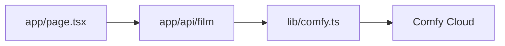

# From local ComfyUI to a standalone app

Slides and script for a 20-minute live tutorial for developers who already use ComfyUI but haven't built on it from code. It follows [Deploying a local ComfyUI workflow as an app](from-workflow-to-app.md) stage by stage, so viewers can reread any part afterwards. The deep dive at the end comes from [How Dreams Studio calls the Comfy API](how-the-app-works.md).

How this file is laid out:

- Slides are separated by `---`.
- Everything above **Script** goes on the slide.
- **Script** is the speaker notes: what to say.
- **Do** is a live action. **Show** is a screen to switch to.
- `[IMAGE: …]` marks where a screenshot goes. The tutorial's `docs/images/` files cover most of them.

| Time | Section | Live on screen |
| --- | --- | --- |
| 0:00 to 1:30 | Intro: what we're building | Start a film in the finished app |
| 1:30 to 5:00 | Stage 1: Bring the workflow to Comfy Cloud | The local workflow in Comfy Cloud |
| 5:00 to 6:30 | Stage 2: Prototype the app in APP mode | The APP mode form |
| 6:30 to 9:00 | Stage 3: Call the workflow through the Comfy API | The Deploy page, `first_call.py` |
| 9:00 to 17:00 | Stage 4: Build the app by hand | Live coding `examples/minimal-app`, a real job |
| 17:00 to 19:00 | What the full app adds | The film from the intro, four files |
| 19:00 to 20:00 | Recap | The hand-built app's job |

---

## 1. Today: a local workflow becomes an app (0:00)

[IMAGE: the finished app next to a frame from a film]

**The workflow:** a few text prompts become a short first-person film with sound

- A keyframe image from a written scene
- Three MiniMax H3 clips, each continuing from the last frame of the one before
- One stitched film

**The four stages:**

1. Bring the workflow to Comfy Cloud
2. Prototype the app in APP mode
3. Call the workflow through the Comfy API
4. Build a standalone app

**Do:** In the app, load **Skeleton cavern**, choose **10 s** clips, and select **Make the film**. It finishes before stage 4.

**Script:** "Today we take one ComfyUI workflow from my machine to an app anyone can run. Here's the end result. I'm starting a film now, against the real Comfy API, and we'll come back to it. You write a style, a scene, and three actions. The workflow draws a keyframe, then makes three video clips that each pick up on the last frame of the one before, and stitches them into one film with sound. We'll get there in four stages, and the repo and a written tutorial cover every step, so you can do the same with your own workflow."

---

## Stage 1: Bring the workflow to Comfy Cloud

---

## 2. Why Comfy Cloud (1:30)

- The canvas you know, on Comfy's GPUs
- More powerful hardware and models than a local machine
- Two things change: **only catalog nodes run**, and **every run spends credits**

**Script:** "This started as a local workflow on my own GPU. It worked, but it was slow, and the output was lower quality than I wanted. MiniMax H3's text encoder alone didn't fit in my GPU's memory. Comfy Cloud is the same canvas, running on much bigger GPUs, with the models already installed. Two things change when you move, and this stage handles both before we write any code."

---

## 3. Swap custom nodes for catalog nodes (2:15)

[IMAGE: the local workflow in Comfy Cloud, flagging a custom node that isn't in the catalog]

| Local node | Comfy Cloud replacement |
| --- | --- |
| `UnetLoaderGGUF`, `CLIPLoaderGGUF` | Core `UNETLoader`, `CLIPLoader` + Comfy Cloud's int8 files |
| `SeamlessContinuationLastFrame` | Core `ImageFromBatch`, index −1 |
| `SeamlessContinuationStitch` | Core `VideoTemporalCrop` + `ConcatenateVideo` |
| `VRAM_Debug` | Delete it |

**Show:** Drag `workflows/Local/minimax_continuation_krea_workflow.json` onto the Comfy Cloud canvas.

**Script:** "Comfy Cloud runs core nodes and the public packs in its catalog. You can't install your own packs there. So step one is an audit. This local version uses five custom nodes from three packs, and Comfy Cloud shows you which ones it doesn't have. GGUF is a compressed format for squeezing big models onto a consumer GPU, and Comfy Cloud doesn't need it, so the core loaders take over. My two continuation nodes did small jobs that core nodes already do. The memory debug node just goes. If a node has no catalog equivalent, there's a build path with its own endpoint, and the tutorial links to it."

---

## 4. Partner Nodes and open weights (3:15)

- **Open weights** run on Comfy Cloud's GPUs: you pay for GPU time
- **Partner Nodes** call a provider's API: you pay per call, on top of GPU time
- Some models exist both ways, so check the price before you choose
- Dreams Studio: open-weights MiniMax H3 for video, Nano Banana for the keyframe

**Script:** "ComfyUI supports open-weights models and models served directly by partners. Open weights run inside your workflow on Comfy Cloud's GPUs. A Partner Node sends the request to the provider, like Google's Nano Banana, and bills per call. Some models exist both ways, so compare before you pick. I kept the open-weights MiniMax H3 for the video and used one Partner Node, Nano Banana, for the keyframe, in place of the Krea 2 keyframe I had locally. Remember Partner Nodes; they come back in stage 3."

---

## 5. Run it once in the browser (4:15)

[IMAGE: the Dreams Studio workflow on the Comfy Cloud canvas]

- Open `workflows/dream_film.json`: the swaps are already done
- Low-cost test: **Length** `124` (5 s clips), keyframe switch off, upload `default-keyframe.png`
- If it runs here, it runs from code

**Show:** The canvas with its groups: prompts, keyframe, clips 1 to 3, stitch. Point at the switch and at **Save keyframe** after it.

**Script:** "Before any code, run it once in the browser. Here's the Comfy Cloud version with all the swaps done. For a cheap test, set Length to 124 frames, which is 5-second clips, and turn off the keyframe switch so it uses an image you upload instead of calling Nano Banana. The seam between clips is the trick: each clip starts on the last frame of the one before, so clips 2 and 3 drop that repeated frame before the stitch."

---

## Stage 2: Prototype the app in APP mode

---

## 6. APP mode: a form before you write one (5:00)

[IMAGE: Dreams Studio as an APP mode form in Comfy Cloud]

- Pick the inputs; Comfy Cloud builds the form
- Shows a Partner Node's price before you run
- Using it like a user shows where the logic breaks

**Show:** Switch the workflow to **App**.

**Script:** "Before I built my own UI, I used APP mode. You choose which inputs to expose, and Comfy Cloud gives you a form with a Run button. It's a prototype for free. It makes you decide what a user should touch, and it even shows the Partner Node price for the keyframe before you run."

---

## 7. Choose the inputs for the form (5:45)

| In the graph | APP mode | Standalone app |
| --- | --- | --- |
| Style, scene, Avoid, three actions | Text boxes | Text boxes |
| Keyframe switch + **Load Image** | Toggle + image | **Generate** or **My image** |
| Width, Height | Exposed | Fixed at 768 × 1344 |
| Total Frames | Any number | **5, 10, or 15 s** (124, 243, 362 frames) |

- One titled node per value a user changes
- Derived values computed in the graph (seam crop = **Length** − 1)
- Output nodes after the switch, so the skipped branch never runs

**Script:** "The workflow is already shaped for an app. Every value a user changes lives in one titled node, so there's exactly one place to set it. The seam crop is computed from Length in the graph, so nothing can disagree. And Save keyframe sits after the switch: an output node before it would run Nano Banana, and bill for it, even with the switch off. Then the form taught me the main lesson. MiniMax H3 only accepts frame counts of 17 times k plus 5. A user can't know 362 works and 360 doesn't. So the app fixes the size and offers three lengths. Put only real choices in front of a user, and do the math for them."

---

## Stage 3: Call the workflow through the Comfy API

---

## 8. The Comfy API: your workflow, from code (6:30)

[IMAGE: the Deploy page on the Developer Platform]

- Endpoint: `https://cloud.comfy.org`, shared, **Managed**, **Always on**
- Your code sends the API format workflow with every call
- Each call creates a **job** with an ID you poll
- You need: an API key, the API format export, an SDK call

**Show:** Comfy Cloud → **Deploy to Comfy API** → **Comfy API** > **Deploy**. Point at **Copy for agents**.

**Script:** "The Comfy API runs your workflow from a script, a backend, or an app. For a workflow that uses only catalog nodes, there's nothing to upload or build. The endpoint already exists, and your code sends the whole workflow with every call. Each call creates a job, and you poll the job for its status and outputs. The Deploy page on the Developer Platform has a Copy for agents button. I pasted that into Claude Code with my export, and it wrote the first version of the script you're about to see."

---

## 9. Key and export (7:15)

**Save format** (the nodes on the canvas)

```json
{ "id": 2213, "type": "Basic data handling: IntCreate", "title": "Length",
  "pos": [396.6, 12.4], "size": [270, 58], "widgets_values": ["362"] }
```

**API format** (what code sends)

```json
"2213": { "class_type": "Basic data handling: IntCreate",
          "_meta": { "title": "Length" }, "inputs": { "value": "362" } }
```

- Key: platform.comfy.org → API keys, into `COMFY_API_KEY`, never into code
- Export: **Export (API)**. The API rejects the save format

**Script:** "Two pieces of setup. An API key, which belongs to a workspace and spends its credits. It goes in an environment variable, never in code and never in a chat with an agent. And the workflow in API format. Save gives you the nodes as they sit on the canvas. Export API gives you just class types and inputs, keyed by node ID. That node ID is how code addresses everything from here on: this is node 2213, input value."

---

## 10. First call from Python (8:00)

```python
client = Comfy()                                  # reads COMFY_API_KEY
wf = client.workflows.from_file("workflows/dream_film.api.json")

wf.set_input("2213", "value", "124")              # Length: 5 s clips
wf.set_input("2201", "switch", False)             # use Load Image
wf.set_input("8", "image", client.assets.from_file("workflows/default-keyframe.png"))

job = client.submit(wf, api_key=os.environ["COMFY_API_KEY"])   # key again, for Partner Nodes
job = job.result()                                 # polls until a final status
job.get_outputs("901")[0].to_file("results/film.mp4")
```

**Show:** The script, and the film it saved to `results/` during rehearsal. Run it live only if you're ahead of time.

**Script:** "Here's the whole thing in Python. Make a client, load the export, set three inputs by node ID, submit, wait, save the film. One line to point out: submit takes the API key a second time. The client's key authenticates the call, but a Partner Node needs the key inside the job. My script passes it even with Nano Banana switched off, so flipping the switch doesn't break it. Save the bytes when you get them, because output links expire. Next, we'll write the same thing as a web app, by hand."

**If a live run fails:** Print `exc.error`, which holds the failed node and the cause. That's the stream-friendly recovery: read the cause out loud and fix it.

---

## Stage 4: Build the app by hand

---

## 11. Build it by hand (9:00)



| File | What it does |
| --- | --- |
| `lib/comfy.ts` | Load the export, set inputs by node ID, submit, check a job |
| `app/api/film/route.ts` | `POST`: submit, return the job ID |
| `app/api/film/[id]/route.ts` | `GET`: status, and the film's link when it's done |
| `app/page.tsx` | A text box, a button, a poll every 5 seconds, a video |

**Do:** The live build, from an empty starter on the MacBook (`next`, `react`, and `@comfyorg/sdk` already installed, key in `.env.local`). Type `lib/comfy.ts`, the two routes, `app/page.tsx`, then `npm run dev` and **Make the film**. The finished code is `examples/minimal-app/`.

**Script:** "Now let's build it. Four files, about 60 lines. The library file is the whole SDK story, the same four steps as the Python script. The two routes keep the key on the server, because the browser never talks to Comfy. The page submits, then polls every 5 seconds until the job reaches one of four final statuses. Let's run it." Then submit a real job and show the network tab.

---

## 12. What the full app adds (17:00)

[IMAGE: Dreams Studio with a finished film]

**Do:** Switch to Dreams Studio. Play the film started at 0:00.

- **Named inputs:** `workflows/dream_film.inputs.json`, so code says `style`, never `2001`, and a re-export changes one file
- **Input checks before a paid job:** `lib/requests.ts`
- **All seven statuses** mapped to what the page shows: `lib/dream.ts`
- **Errors as sentences** a user can act on: `lib/job-error.ts`
- Every form field, the keyframe choice, and a double-click launcher

**Script:** "Here's the film we started at the beginning, in the full app. It's the same 60 lines you just watched, plus four things you'd want before anyone else uses it. Named inputs, so a re-export never breaks the code. Input checks, so bad input never costs credits. Every status handled. And errors a person can act on. All of it is in the repo, and the tutorial walks through each one."

**Do (free, if time allows):** Switch the keyframe to **My image** and upload a text file renamed to `.png`. The app rejects it before any job starts.

---

## 13. Recap (19:00)

1. **Comfy Cloud:** swap custom nodes for catalog nodes, choose open weights or Partner Nodes, run it once in the browser
2. **APP mode:** put only real choices in front of a user
3. **Comfy API:** an API key plus the API format export; Partner Nodes need the key in the job
4. **Standalone app:** name your inputs, submit, poll, read outputs by node ID

Repo: `github.com/XXJones21/Dream-studio` · Tutorial: `docs/from-workflow-to-app.md` · Deep dive: `docs/how-the-app-works.md`

**Do:** Switch back to the hand-built app. If its film has arrived, play it.

**Script:** "Clone the repo, swap in your workflow, rename the inputs, and run the tests. Everything I showed is in the tutorial." Then drop the presenter voice for the SDK feedback.

---

## Before going on stage

1. **Credits:** check the workspace balance covers the intro film, the hand-built app's film, and a retry.
2. **App:** started with `start-mac.command`, open at `127.0.0.1:3000`, **Skeleton cavern** loaded.
3. **Live build:** `examples/minimal-app` installed on the MacBook with `.env.local`, the four files saved to `~/mini-done` and removed, VS Code open on the folder with the font enlarged.
4. **Python:** `.venv` active in a terminal at the repo root, `COMFY_API_KEY` set, `first_call.py` saved.
5. **Comfy Cloud tabs:** `dream_film.json` on the canvas, the local workflow ready to drag in, APP mode, and the Deploy page.
6. **Fallbacks:** a finished film downloaded and open in a player; a text file renamed to `.png` on the desktop; Moonlight to the desktop over Tailscale if the MacBook misbehaves.
